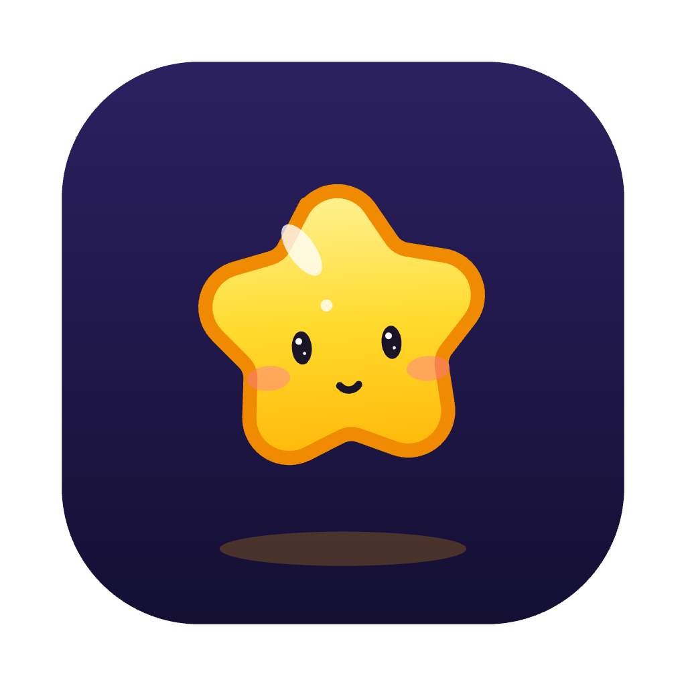

<p align="center">
  
</p>

<h1 align="center">Halo</h1>

<p align="center">
  <b>A little companion. A lot done.</b><br>
  A small AI companion that lives on your desktop and brings your work into one place.<br>
  macOS and Windows · runs on your own Claude Code login
</p>

<p align="center">
  
  
  
  
  
</p>

---

## What it does

- **What needs you, in one place.** Ninety Rocks, Jira issues, GitHub reviews and pull requests, and Slack mentions, sorted into four quadrants: Do now, Schedule, Delegate, Later.
- **Ask by typing or out loud.** Say “Hey Halo” and talk back and forth. Halo answers aloud, then listens for your reply.
- **Show it your screen.** Drag Halo onto a window and hold still for a moment: it explains what's there. Or snip a region.
- **Meeting notes.** Halo notices your calls, keeps You and Them apart, transcribes on your computer, and writes a summary with action items.
- **Runs on a schedule.** *Pieces* are plain-English checks that run every few hours. *Recap* writes up your day or week.
- **Watches your Claude Code sessions.** See what each one is doing, hear when one finishes, and approve its requests from Halo if you turn that on.
- **Remembers.** Memory, chat history, and skills you can add from a link.
- **Five characters**, drawn in code: Nova, Sunny, Luna, Orbit and Mimi. They follow your pointer, rest in the notch, and come in day and night themes.

## How it works

Halo is an Electron app that drives the Claude Code CLI you already use: your login, your connectors, your skills. There's no API key and no separate bill. You can add your own API key in Settings if you want to.

| Piece | How |
|---|---|
| Chat | `claude -p` with streaming JSON, one warm session per chat |
| Background checks | `claude -p --json-schema` for structured answers (Rocks, Slack, Recap, Pieces) |
| GitHub · Jira | `gh` and `acli`, run locally for fast checks that don't use your plan |
| Ninety · Slack · Gmail · Calendar | Claude Code connectors |
| Speech | Whisper on your device (transformers.js + ONNX Runtime) |
| Approvals | A PreToolUse hook asks Halo before every tool call. Reads run; anything that sends or changes something waits for your Allow |

## Privacy and safety

- Audio stays on your computer and is deleted once the notes are written.
- Screenshots are taken only when you ask.
- Nothing is sent, posted or changed until you click **Allow**.
- Text from emails, messages and web pages is treated as information, never as instructions.
- Reading keys, `.env` files, keychains or browser profiles always needs your OK.

## Get started

You need [Claude Code](https://claude.com/claude-code) installed and signed in, and Node 22 or later. `gh` (GitHub) and `acli` (Jira) are optional.

```bash
git clone https://github.com/pranav-modem/Halo.git
cd Halo
npm install
npm start
```

On macOS, allow **Microphone** and **Screen & System Audio Recording** when Halo first asks, then reopen it.

## Development

| Command | What it does |
|---|---|
| `npm start` | Run Halo from source |
| `HALO_DEBUG=1 npm start` | Also print every window's console to the terminal |
| `npm run check` | Syntax-check every source file |
| `npm run gallery` | Every character in every state, at `localhost:5180/renderer/gallery.html` |
| `npm run icons` | Re-render the app and tray icons from the characters |
| `npm run dist:mac` · `npm run dist:win` | Build the installers into `dist/` |

```
src/
  main/        app start-up, windows, Claude Code bridge, approvals, data sources
  renderer/    the companion, chat window, room, island; characters/ is the drawing engine
  hook/        Claude Code hooks (run by Halo's own Electron binary)
  preload/     the only bridge between pages and the main process
  shared/      character definitions
scripts/       checks, icon rendering, packaging
```

## Contributing

Ideas, bug reports and pull requests are welcome. See [CONTRIBUTING.md](CONTRIBUTING.md).

## License

No license has been chosen yet, so all rights are reserved for now.

## Authors

Pranav Modem and Claude.
