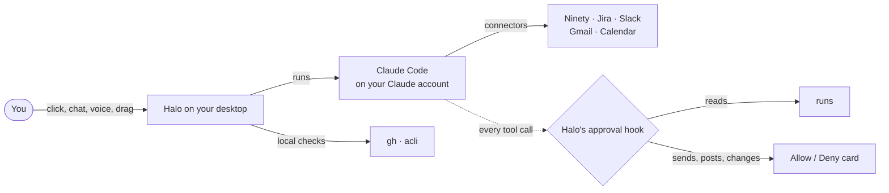

<p align="center">
  
</p>

<h1 align="center">Halo</h1>

<p align="center">
  <b>A little companion. A lot done.</b><br>
  A small AI companion that lives on your desktop. It finds what needs you across Ninety, Jira, GitHub, Slack, Gmail and Calendar, answers by text or voice, explains any window you drop it on, takes your meeting notes, and asks before anything goes out.
</p>

<p align="center">
  
  
  
  
  
</p>

Halo thinks with [Claude Code](https://claude.com/claude-code) on your own Claude account: no API key and no separate bill. It reaches your tools through the connectors you've already set up in Claude Code, plus the GitHub (`gh`) and Jira (`acli`) command-line tools. It runs on **macOS and Windows**.

## How it works

A typical moment, from start to finish:

**1. Something needs you.** Halo checks GitHub and Jira every few minutes on your computer, and Ninety and Slack through Claude Code every hour. When a review is waiting or a Rock goes off track, the character bounces and shows a speech bubble. Everything lands on the **What needs you** board, sorted into four quadrants.

**2. Ask.** Click Halo, or say *“Hey Halo, what should I do first?”* The answer streams into the chat window, with small chips showing what Halo is doing (“Checking Ninety…”, “Reading the PR…”). Asked out loud, it reads the start of the answer back and waits for your reply.

**3. One click before anything goes out.** Reading runs on its own. Sending a Slack message, commenting on a ticket, updating a Rock or running a command shows an **Allow / Deny** card with the exact text and where it's going. Nothing leaves your computer until you click **Allow**.

**4. Done.** The character does a happy hop, and the item can be marked **Done** on the board.

Behind the scenes:



Every tool Claude Code wants to use goes through Halo's approval hook first. Reads go ahead. Anything that sends, posts or changes something waits for your click. Scheduled checks only ever read. If Halo isn't there to answer, the request is denied.

## What it does

### What needs you

One board for everything waiting on you, sorted with the Eisenhower method:

| Quadrant | What goes there |
|---|---|
| **Do now** | Urgent and important: failing checks on your PRs, Rocks off track, direct asks |
| **Schedule** | Important, not urgent: reviews waiting, Jira work in progress |
| **Delegate or reply quickly** | Urgent, not important: Slack mentions, quick answers |
| **Later** | Everything else |

Below the quadrants each source has its own list: Ninety Rocks, pull requests waiting for you, your open pull requests with their checks, Jira issues assigned to you, and Slack mentions from the last day. Every row has an action: **Review**, **Fix it**, **Draft a reply**, **Ask**.

- **Check now** refreshes everything and stays locked until the answer is back.
- **Ask Halo to prioritize** sends the whole list to Claude for a one-line reason per item and the first thing to do.
- GitHub and Jira are checked every 5 minutes on your computer. This uses none of your Claude plan.
- Ninety and Slack are checked every hour through Claude Code. Each check uses a little of your plan.
- You can change both timings in Settings → Alerts.

### Ask Halo

The chat window opens next to the character.

- **Models and effort:** Default, Opus, Sonnet or Haiku, and an effort level, from the menu at the top.
- **Chats:** the ☰ lists recent chats. Pick one to carry on, or **+ New**.
- **Quick asks:** *Brief me*, *My Rocks*, *PRs to review*, *My Jira*, *Slack mentions*, *Explain my screen*.
- **Times:** Halo knows your computer's time zone and your calendar account's, converts every time to yours, and leaves out meetings that have already ended.
- **Full screen** when you need room. **Day and night** themes from the header.
- **Local commands:** *“stop following me”* and *“follow me”* are handled by Halo itself, typed or spoken.

### Show it your screen

- **Drag Halo onto any window and hold still for a moment.** The window lights up. Let go, and Halo tells you what's happening in it. A quick drag just moves Halo.
- **⌘⇧Space** (Ctrl+Shift+Space on Windows) captures the screen you're on.
- **⌘⇧X** lets you snip a region.

Screenshots come with quick follow-ups: *Explain*, *Summarize*, *Draft a reply*, *Find the bug*, *Jira ticket*. Halo hides itself while it captures, and takes screenshots only when you ask.

### Talk to it

- **“Hey Halo”** or your character's name (*“OK Nova”*) wakes it. Recognition runs on your computer with a small Whisper model, and only the words after the wake phrase go to Claude, never audio.
- **Conversations keep going.** After Halo answers out loud, just reply. It listens for about 8 seconds more, and it ignores its own voice coming back through the speakers.
- **Hush it** with *“Hey Halo, stop”*, Esc, the Stop button, or by starting to type.
- **“Hey Halo, stop listening”** turns the wake word off until you turn it back on: the mic button in the chat header, the menu, or Settings.
- **Dictate** with the mic button or **⌘⇧D**. It stops when you stop talking and sends your question.

### Meeting notes and calls

Halo notices Zoom, Teams, Google Meet, Webex, Slack huddles and FaceTime calls and offers to take notes. It never starts on its own. Tell the people on the call that you're taking notes.

- **You and Them:** your microphone and the call's audio are recorded separately, so the transcript knows who said what.
- **On your computer:** Whisper transcribes the audio locally. The audio is deleted once the notes are written, and kept until then so a failed part can be retried.
- **Two passes by Claude:** the first fixes misheard words without rephrasing anything. The second writes a title, a summary, key points and to-dos, marking which ones are yours.
- **Editable afterwards:** in the room's **Calls** page you can rename a speaker (giving two speakers the same name merges them), move a line to whoever really said it, rewrite it or delete it.
- **Follow-ups**, each one still asking for your OK: make Jira tickets from the action items, add To-Dos to Ninety, post the summary to Slack.
- Notes are saved as Markdown, next to a `.note.json` holding the speakers and lines.

You can also paste a transcript, or jot a quick note.

### Your Claude Code sessions

Home shows what your own Claude Code sessions are doing, wherever they run: Terminal, the Claude app or VS Code.
- Each one shows its project, your latest message and the step it's on.
- **↗** brings its app to the front.
- When a session finishes a turn, Halo says so in a bubble. When one asks you a question or has a plan ready, Halo shows "<project> needs you".

Halo reads the transcripts Claude Code already keeps on your computer, so nothing is installed to see your sessions.

**Approve from Halo** is optional (Settings → Claude Code). Turning it on adds Halo's hooks to `~/.claude/settings.json`:
- Halo backs the file up, shows you the exact change, and writes only after you confirm.
- Other tools' hooks are left alone.

Permission requests then appear in Halo with **Allow**, **Always**, **Deny** or **Reply in Claude Code**. If Halo isn't running, Claude Code asks in the terminal as usual.

### Pieces

Pieces are plain-English jobs Halo runs on its own schedule. They only read, and they come back as a speech bubble plus items on the board.

| Piece | When | Starts |
|---|---|---|
| Morning brief | 09:00, Monday to Friday | on |
| Pending items | every 2 hours | off |
| Stale PRs | 14:00, Monday to Friday | off |

Add your own in the room: a name, a time (*every 30m*, *every 2h*, or *at 16:30 on mon-fri*) and what to check, for example *“Tell me which of my Jira tickets nobody has touched in three days.”* **Run now** tries one immediately.

### Recap

What you got done today or this week:
- **The numbers** come from Halo: chats, calls and minutes, notes written, and things marked Done.
- **The written recap** reads GitHub, Jira, Ninety, Slack, your calendar and your meeting notes.
- Each recap is saved as Markdown, so you can look back at it.

### Memory, history and skills

- **Memory:** what Halo knows about you and your work. Every chat starts with it. Say *“remember that my manager is Sam”*, or add and forget items in the room.
- **History:** every chat with Halo. Open one to read it, or **Continue this chat**.
- **Skills:** everything your Claude Code can use, from your own skills and your plugins. Paste a link to a skill and Halo fetches it, tells you what it does and which files it will add, and installs it after you allow it. It never runs a downloaded skill's scripts while installing.

### The room

Settings ⚙ in the chat window, or **Halo's room…** in the menu, opens the big window:
- **Pages:** Home, Memory, Notes, Calls, Pieces, Skills, History, Recap and Activity.
- **Settings:** General, Look, Claude Code, Integrations, Alerts, Notes and voice, and Shortcuts.
- **Integrations** shows which connectors and command-line tools are ready, and which macOS permissions are granted.

## Halo's look

Five characters, drawn in code on a canvas with no image files. Each has its own personality in chat:

| | Character | Motion |
|---|---|---|
| ⭐ | **Nova**, a joyful spark | rotates, pulses, twinkles |
| ☀️ | **Sunny**, a positive presence | glows, pulses, beams |
| 🌙 | **Luna**, a calm companion | rocks, glows, sleeps |
| 🪐 | **Orbit**, a dreamy soul | orbits, spins, sparkles |
| 👻 | **Mimi**, a gentle ghost | floats, fades, reappears |

Halo's eyes follow your pointer, it blinks and breathes, and it shows what it's doing:
- **Thinking** and **working:** a small badge.
- **Talking:** its mouth moves.
- **Needs you:** it bounces with an amber "!".
- **Done:** a happy hop.
- **Asleep:** it dozes after a while.

- **Follow my pointer:** Halo walks after your mouse across windows and screens, and stops just short of it. Turn it off in Settings → General or the menu, or tell it *“stop following me”*.
- **The island:** double-click Halo to rest it at the top centre of the screen, next to the notch. Click the island to open the chat; drag it down to bring Halo back out.
- **Every desktop:** the character and the chat follow you across macOS Spaces and full-screen apps.
- **Day and night** themes, with day as the default, or match your system. Three sizes.

## Keyboard shortcuts

These work from any app. ⌘ is Ctrl on Windows. Change them in Settings → Shortcuts.

| Shortcut | What it does |
|---|---|
| ⌘⇧B | Open or hide the chat |
| ⌘⇧Space | Show Halo your screen |
| ⌘⇧X | Snip a region |
| ⌘⇧R | Start or stop recording a meeting |
| ⌘⇧D | Talk to Halo |

In the chat, **Y** and **N** answer an approval card, and **Esc** hushes Halo or closes the window.

## What Halo may do

| | Without asking | Asks first |
|---|---|---|
| Read your tools | Ninety, Jira, GitHub, Slack, Gmail, Calendar | none |
| GitHub and Jira commands | `gh` and `acli` reads, optionally piped through `jq`, `grep`, `head`, `wc`, `sort` or `uniq` | everything else, including any `gh api` call that isn't a plain read |
| Read files | yes | keys, passwords, tokens, `.env` files, keychains and browser profiles |
| Write files | Markdown notes in your notes folder, and its memory file | everything else, including Claude Code settings and `CLAUDE.md` |
| Send, post, comment, create, update | never | every time, with the exact text and target |
| Open a web page | never | every time |
| Scheduled checks | read only | they never send, change or write anything |

Text in emails, messages, tickets and web pages is information to Halo, never instructions. **Always** on an approval card never covers shell commands, file edits or web pages.

## Install

Build the installers from source (below), or download them from the repository's releases when there are some.

- **macOS:** open `Halo-<version>-mac-arm64.dmg` and drag Halo into Applications. Builds that aren't signed with an Apple Developer ID need a right-click → **Open** the first time.
- **Windows:** run `Halo-<version>-windows-setup.exe`, or unzip `Halo-<version>-windows-x64.zip`. Unsigned builds show a SmartScreen warning; choose **More info → Run anyway**.

You also need:
- **[Claude Code](https://claude.com/claude-code)**, installed and signed in (run `claude` once). Your connectors come from your Claude account.
- **`gh`** and **`acli`**, if you want the GitHub and Jira parts. Optional.

On macOS, Halo asks once for:
- **Microphone:** voice and meeting notes.
- **Screen & System Audio Recording:** looking at a window, and hearing the other side of a call.

Quit and reopen Halo after you allow screen recording.

## Build from source

You need Node 22 or later.

```bash
git clone https://github.com/pranav-modem/Halo.git
cd Halo
npm install
npm start
```

| Command | What it does |
|---|---|
| `npm start` | Run Halo from source |
| `HALO_DEBUG=1 npm start` | Also print every window's console to the terminal |
| `npm run check` | Syntax-check every source file |
| `npm run gallery` | Every character in every state, at `localhost:5180/renderer/gallery.html` |
| `npm run icons` | Re-render the app and tray icons from the characters |
| `npm run dist:mac` | Build the macOS `.dmg` into `dist/` |
| `npm run dist:win` | Build the Windows installer and zip into `dist/` |

On macOS, `npm run dist:mac` signs with your Apple Development or Developer ID certificate when it finds one, so permissions survive reinstalls. `scripts/make-signing-cert.sh` creates a local signing certificate if you have neither.

## Where things live

```
~/Documents/Halo/                 Halo's workspace (where its Claude Code runs)
  memory.md                       what Halo remembers about you
  Recaps/                         your day and week recaps
~/Documents/Halo Notes/           meeting notes and quick notes (.md + .note.json)

App data: ~/Library/Application Support/Halo on macOS, %APPDATA%\Halo on Windows
  settings.json                   your settings, pieces, recent chats and call log
  secrets.json                    API keys, encrypted with the system keychain
  models/                         the on-device speech models
  notes-audio/                    meeting audio, kept only until the notes are written
```

Both folders can be changed in Settings.

## Project layout

```
src/
  main/            app start-up and windows, the Claude Code bridge and chat, approvals,
                   GitHub and Jira checks, alerts, meeting notes, calls, pieces, recap,
                   and your Claude Code sessions
  renderer/        what you see: the desktop companion, the chat window, the room and
                   the island; characters/ is the drawing engine for all five characters
  hook/            Claude Code hooks, run by Halo's own Electron binary
  preload/         the only bridge between the pages and the main process
  shared/          the characters' names, shapes and personalities
scripts/           checks, icon rendering, packaging and signing
assets/            app and tray icons, and a still of each character
```

## Contributing

Ideas, bug reports and pull requests are welcome. See [CONTRIBUTING.md](CONTRIBUTING.md) for setup, conventions and the safety rules every change keeps.

## License

No license has been chosen yet, so all rights are reserved for now.

## Authors

Pranav Modem and Claude.
